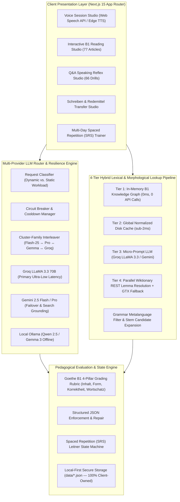

# SprachCoach 🎙️🇩🇪 — Production-Grade AI German Tutor & Goethe B1 Studio

[](https://www.typescriptlang.org/)
[](https://nextjs.org/)
[](https://groq.com/)
[](https://ai.google.dev/)
[](#automated-ai-evaluation-suite-evalai)
[](LICENSE)

> **A Voice-First, Local-First AI German Coach & Goethe-Zertifikat B1 Exam Studio.**
> Built with Next.js 15 App Router, dual-provider LLM failover routing (Groq LLaMA 3.3 70B & Gemini 2.5 Flash), a 4-tier hybrid lexical lookup pipeline, official 4-pillar CEFR rubric grading, and a Spaced Repetition (SRS) memory engine.

---

## 🏛️ System Architecture



---

## 🚀 Key AI Engineering Highlights

### 1. Dual-Provider LLM Failover & Cluster Interleaving
- **The Challenge**: Real-time voice coaching requires deterministic <1.5s latency. Single-provider cloud APIs frequently suffer from transient 503 cluster overloads and 429 quota spikes. Naive retries on aliases of the same overloaded model (e.g., `gemini-2.5-flash` → `gemini-flash-latest`) exhaust quota without resolving the bottleneck.
- **The Solution**: 
  - An intelligent **Model-Family Interleaver** (`src/lib/ai/providers.ts`) that groups models into distinct physical serving clusters (`flash-25`, `pro`, `flash-20`, `gemma-27b`, `groq-llama33`). When a cluster fails, failover immediately jumps across clusters.
  - Automatic cross-provider failover: **Groq LLaMA 3.3 70B Versatile** as low-latency primary (sub-400ms TTFT), failing over to **Gemini 2.5 Flash** with exponential backoff.
  - Active circuit breakers that put failing models on a 90-second cooldown, routing live voice turns without dropped sessions.

### 2. 4-Tier Hybrid Lexical Lookup Pipeline (Sub-10ms Resolution)
- When reading authentic German texts, learners click unfamiliar words (inflected adjectives like *„spannenden“*, separable verbs like *„ausführen“*, or compounds like *„Lebkuchen“*). Calling an LLM for every single word click is expensive and introduces 800ms+ latency.
- **Hierarchical Resolution Architecture**:
  - **Tier 1 (0ms)**: Scans the curated 77-article B1 Knowledge Graph for exact and inflected matches.
  - **Tier 2 (<2ms)**: Queries the normalized global disk cache (`data/assist-cache.json`).
  - **Tier 3 (Fast AI)**: Calls Groq/Gemini with a micro-prompt constrained to 90 tokens with a 6.5s timeout.
  - **Tier 4 (Offline Fallback)**: Parallel Wiktionary REST lemma resolution combined with Google GTX fallback.
- **Grammar Metalanguage Filter**: Filters out raw declension metadata (e.g. *„strong genitive masculine singular“*) from Wiktionary inflection pages, extracting the true lexical meaning (*„exciting, thrilling“*) alongside 2–3 contextual example sentences.

### 3. Official Goethe B1 4-Pillar Writing & Speaking Rubric
- Automated grading strictly implements the official Goethe-Institut / telc B1 4-pillar evaluation criteria (25 points each = 100 total; passing threshold: 60/100):
  1. **Inhalt / Erfüllung (0–25)**: Evaluates coverage of all mandatory bullet points (*Leitpunkte*) and target word length.
  2. **Kommunikative Gestaltung (0–25)**: Evaluates register (*formell* vs. *informell*), salutations, transitions, and closing formulas.
  3. **Korrektheit (0–25)**: Proportional deductions for verb-position errors (e.g., *weil* verb-at-end, verb-second after connectors), case endings, and capitalization.
  4. **Wortschatz (0–25)**: Evaluates lexical range, B1 connectors (*obwohl, deshalb, einerseits... andererseits*), and flags anglicisms.
- Generates line-by-line sentence corrections, improved native rewrites, and advanced B2 level-up suggestions.

### 4. Spaced Repetition System (SRS) State Machine
- Multi-day retention algorithm based on Leitner and SM-2 principles:
  - **Daily Milestone**: Reaching 3x correct matches in one calendar day marks an item as *"Done for today"* and schedules it for tomorrow.
  - **Permanent Mastery**: Achieving daily completion across 3 distinct calendar days graduates the vocabulary to permanently mastered.
  - **Active Production Bonus**: Independent active-recall writing streak adds production credit (+0.25).
  - **Lapse Recovery**: Incorrect answers flag `needsRetry: true` and reset the current streak.

---

## 🧪 Automated AI Evaluation Suite (`eval:ai`)

To maintain production reliability, the project includes an automated test and evaluation suite runnable via `npm run eval:ai`. It tests LLM schema adherence, mathematical invariants, and lookup resolution without external network dependencies:

```bash
npm run eval:ai
```

```text
======================================================
      SprachCoach AI Systems & Evaluation Suite       
======================================================

Suite 1: Goethe B1 4-Pillar Scoring & Structured JSON Rubric
  ✓ extractJsonObject cleanly extracts JSON wrapped in markdown code fences
  ✓ extractJsonObject parses bare unadorned JSON with whitespace
  ✓ Goethe B1 4-Pillar mathematical invariant: sum of 4 pillars equals 0..100 total score
  ✓ Goethe B1 Passing Threshold calibration (60% cutoff)

Suite 2: 4-Tier Hybrid Lexical & Morphological Lookup Engine
  ✓ German Stem Candidate Generation handles inflections & prefixes
  ✓ Wiktionary Grammar Metalanguage Filter strips raw inflection tags
  ✓ stripArticle extracts canonical headword from nouns & reflexive verbs
  ✓ Curated B1 Knowledge Graph holds 77 articles across 11 official categories

Suite 3: Spaced Repetition System (SRS) State Machine Benchmark
  ✓ getDateKeyOffset correctly computes date progressions & rollover
  ✓ SRS Practice Item: 3x daily completion marks 'Done for today' with next review tomorrow
  ✓ SRS Practice Item: 3 distinct days achieves permanent mastery
  ✓ SRS Error Lapse: Wrong answer resets streak and marks needsRetry

Suite 4: Multi-Cluster AI Failover Router & Circuit Breakers
  ✓ getGeminiModelFamily accurately groups distinct serving clusters
  ✓ interleaveByModelFamily prevents burning all attempts on identical overloaded cluster
  ✓ Circuit Breaker: marks model on cooldown and expires cleanly

Suite 5: Safe Public Demo Mode & Zero-Quota Isolation
  ✓ App default configuration falls back safely to 'demo' when no API keys are present
  ✓ Offline B1 Curricula: All 11 categories possess full offline Q&A and Redemittel banks

======================================================
Test Results: 17 passed, 0 failed
======================================================
✓ All AI system evaluations and invariant benchmarks passed successfully!
```

---

## 📚 Curriculum & Content Architecture

The application comes pre-loaded with comprehensive B1 curriculum modules across **11 core themes** (8 official Goethe-Institut topics + 3 practical real-world modules):

| Category ID | German Title | English Description | Curated Articles |
|:---|:---|:---|:---:|
| `voc-work` | Arbeit, Beruf & Bewerbung | Work, Careers & Applications | 7 Articles |
| `voc-living` | Wohnen, Alltag & Nachbarschaft | Housing, Apartment Hunting & Neighbors | 7 Articles |
| `voc-health` | Gesundheit, Ernährung & Sport | Health, Nutrition & Doctors | 7 Articles |
| `voc-travel` | Reisen, Verkehr & Mobilität | Travel, Public Transit & Tourism | 7 Articles |
| `voc-environment` | Umwelt, Natur & Konsum | Climate, Recycling & Sustainability | 7 Articles |
| `voc-media` | Medien, Digitales & Kommunikation | Media, Social Networks & Digital Life | 7 Articles |
| `voc-leisure` | Freizeit, Kultur & Feste | Free Time, Hobbies & German Traditions | 7 Articles |
| `voc-education` | Bildung, Lernen & Gesellschaft | Education, University & Lifelong Learning | 7 Articles |
| `voc-banking` | Bank, Geld & Finanzen | Banking, SEPA Transfers & Managing Accounts | 7 Articles |
| `voc-food` | Essen, Trinken & Restaurant | Food Culture, Dining Out & Recipes | 7 Articles |
| `voc-jobsearch` | Jobsuche, Bewerbung & KI-Karriere | AI Engineering Careers, CVs & Interviews | 7 Articles |
| **Total** | **11 CEFR Categories** | **Goethe B1 Official Standard** | **77 Articles** |

Each article includes:
- 3 structured German paragraphs with synchronized English translations.
- 8–10 key B1 vocabulary words with base forms, articles, and practical examples.
- 4 reusable Speaking/Writing transfer expressions (*Redemittel*).
- Integrated Edge Neural TTS voice playback with adjustable speech rate.

---

## 🔒 Safe Public Demo Mode & Local-First Privacy

- **Zero-Quota Public Demo**: Over 90% of the platform (all 77 articles, 66 Q&A reflex drills, multi-day SRS matching, dictionary lookups, and neural audio synthesis) operates with zero external API keys.
- **Bring Your Own Key (BYOK)**: Visitors can enter their own free Gemini or Groq key in the Settings page.
- **Local-First Data Isolation**: Runtime data is stored strictly in `data/*.json` on your local disk. The `.gitignore` configuration guarantees that API keys, personal voice recordings, and learning histories are never committed to version control.

---

## 🛠️ Project Structure

```text
├── scripts/
│   └── eval-ai.ts              # Automated AI systems & rubric evaluation suite
├── src/
│   ├── app/
│   │   ├── api/
│   │   │   ├── drills/         # Writing assist, grading & precompute APIs
│   │   │   ├── reading-practice/lookup/ # 4-Tier fast lexical lookup route
│   │   │   └── speaking-practice/       # Q&A drills & interview generation
│   │   ├── train/
│   │   │   ├── reading/        # Interactive B1 Reading Studio & Vocab Pool
│   │   │   ├── speaking/       # Q&A Reflex Drills & Casual Interviews
│   │   │   └── writing/        # Schreiben Studio with 4-pillar grading
│   │   └── settings/           # Multi-provider AI & voice engine configuration
│   ├── components/             # Modular React 19 UI components
│   └── lib/
│       ├── ai/
│       │   ├── coach.ts        # Conversational coaching state machine
│       │   ├── drills.ts       # 4-pillar Goethe B1 evaluation engine
│       │   └── providers.ts    # Multi-provider failover router & circuit breakers
│       ├── lookup-utils.ts     # Stem expansion & grammar metalanguage filtering
│       ├── reading-store.ts    # 77 B1 article banks & local store merging
│       ├── speaking-bank.ts    # Goethe B1 exam parts & reflex drills
│       ├── vocab-pool-store.ts # Spaced Repetition (SRS) state machine
│       └── db.ts               # Local JSON persistence with transaction locking
├── data/
│   ├── sprachcoach-db.example.json # Sanitized template for fresh clones
│   └── .gitkeep                # Tracked data directory structure
└── .env.example                # Free-tier API configuration guide
```

---

## ⚡ Quickstart

### Prerequisites
- Node.js `v20.0.0` or higher (`v22.14.0+` recommended)
- npm or pnpm

### 1. Clone & Install
```bash
git clone https://github.com/<your-username>/sprachcoach.git
cd sprachcoach
npm install
```

### 2. Configure Environment (Optional)
SprachCoach works immediately in offline Demo Mode. To enable live LLM grading, copy the example environment file:
```bash
cp .env.example .env.local
```
Add your free API keys:
- **Google Gemini API Key** (Free): [Google AI Studio](https://aistudio.google.com)
- **Groq Cloud API Key** (Free): [Groq Console](https://console.groq.com)

*(Keys can also be pasted directly in the app's Settings interface at any time).*

### 3. Run the Development Server
```bash
npm run dev
```
Open [http://localhost:3000](http://localhost:3000) in your browser (Chrome or Edge recommended for native German speech recognition and neural voices).

### 4. Run the Evaluation Suite
```bash
npm run eval:ai
```

### 5. Typecheck & Build
```bash
npm run typecheck
npm run build
```

---

## 📄 License
This project is open-source under the [MIT License](LICENSE).
